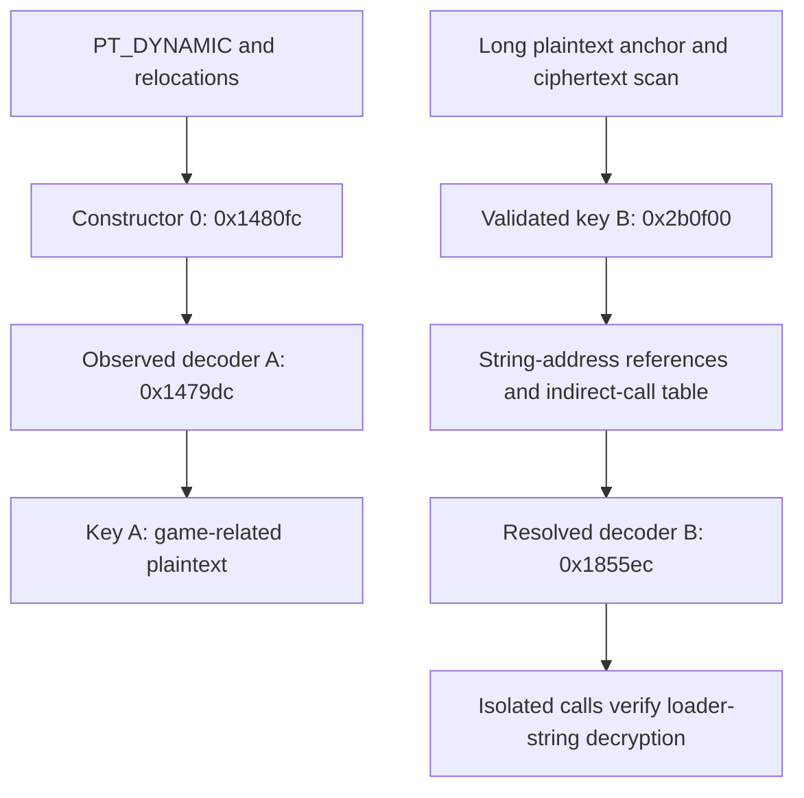

# From an obfuscated constructor to keys, strings, and decoder calls

This walkthrough explains the investigation behind the [family1 report](README.md).
It uses APK1's `libcard86.so` as the main example and APK2's
`libsummitfjord.so` as a comparison. Addresses apply to the original libraries
identified by the hashes in that report, not to arbitrary family members.

You do not need to understand every branch in the enormous initializer. Start
with a smaller question: **which function changes these bytes, what arguments
does it receive, and what do the bytes become?** Each answer gives you a useful
name for something that previously looked like an anonymous block of code.

The minimum background is hexadecimal addresses, basic Python, and the idea
that a pointer is an address. Assembly becomes easier once you can recognize
loads, stores, calls, and XOR. The steps below provide concrete checkpoints so
you can distinguish a successful observation from a plausible guess.

## 1. Establish which library and which starting function you are examining

In a split APK installation, native code can be in the ABI split rather than
`base.apk`. The libraries used here are:

| Sample | Native library in the workspace |
| --- | --- |
| APK1 | `work/family1_apk1/native_libs/arm64-v8a/libcard86.so` |
| APK2 | `work/family1_apk2/native_libs/arm64-v8a/libsummitfjord.so` |

Run the commands in this guide from the workspace root. The report's setup
instructions create `work/reconstructor-venv` if it is not already present.

```bash
unzip -l apks/family1/apk1/split_config.arm64_v8a.apk
readelf -hW work/family1_apk1/native_libs/arm64-v8a/libcard86.so
readelf -lW work/family1_apk1/native_libs/arm64-v8a/libcard86.so
readelf -dW work/family1_apk1/native_libs/arm64-v8a/libcard86.so
```

The ELF header identifies the architecture. Program headers describe what gets
mapped into memory. Dynamic tags identify initialization and relocation data.
Section names are helpful labels, but they are not the sole source of this
information.

An important distinction: `.init_array` is a **table of function pointers**, not
the initializer's instructions. Its functions can live in `.text`. A disassembler's
generated `INIT_0` name is not evidence that the function resides in a literal
`.init` section. `DT_INIT` and `DT_INIT_ARRAY` are separate initialization mechanisms.
See the [ELF dynamic-linking specification](https://gabi.xinuos.com/elf/08-dynamic.html).

For APK1, the checked metadata is:

| Item | Value |
| --- | --- |
| `DT_INIT` | Absent |
| `DT_INIT_ARRAY` | ELF VA `0x2a8878` |
| `DT_INIT_ARRAYSZ` | 32 bytes: four 8-byte pointers |
| Constructor 0 | `0x1480fc` |
| Constructor 1 | `0x28dea4` |
| Constructor 2 | `0x28e128` |
| Constructor 3 | `0x21ae28` |
| Exported `JNI_OnLoad` | `0x7c840`; a separate entry point |

Those constructor values are supplied by relocations. Looking at the unrelocated
array bytes alone can therefore be misleading. Inspect its relocation records:

```bash
readelf -rW work/family1_apk1/native_libs/arm64-v8a/libcard86.so |
  rg '2a8878|2a8880|2a8888|2a8890'
```

**Checkpoint:** you can identify actual constructor targets without guessing
from a large code blob, and you know whether the pointers need relocation.

## 2. Keep file offsets, ELF addresses, and runtime addresses separate

This is a common source of apparently broken keys and invalid pointers.

| Address kind | Meaning | APK1 loader-key example |
| --- | --- | --- |
| File offset | Position in the `.so` bytes on disk | `0x2a4f00` |
| ELF virtual address, or VA | Address described by the ELF mapping | `0x2b0f00` |
| Runtime address | Address after Qiling loads the library | `load_bias + 0x2b0f00` |

For a file-backed address inside a `PT_LOAD` segment:

```text
file_offset = segment.p_offset + (elf_va - segment.p_vaddr)
runtime_address = load_bias + elf_va
```

The APK1 data segment containing the loader key has file offset `0x2a0cd0` and
VA `0x2accd0`. Thus:

```text
0x2a0cd0 + (0x2b0f00 - 0x2accd0) = 0x2a4f00
```

That segment happens to have a VA/file difference of `0xc000`; other segments
have different differences. Do not subtract `0xc000` from every address.

In Ghidra, import the original `.so`, run analysis, and check its image base.
The addresses in this guide are ELF VAs. If Ghidra adds an image-base offset,
account for it before using Go To or passing an address to the script. Useful
features are the Listing, Decompiler, Function Graph, and references to a selected
address; the [official beginner guide](https://ghidra.re/ghidra_docs/GhidraClass/Beginner/Introduction_to_Ghidra_Student_Guide.html)
introduces these views.

## 3. Observe the initializer before trying to understand all its branches

First run a constructor experiment with both XOR discovery routes disabled.
That makes the output attributable to execution rather than a static fallback.

```bash
work/reconstructor-venv/bin/python scripts/elf_plaintext_reconstructor.py \
  work/family1_apk1/native_libs/arm64-v8a/libcard86.so \
  --out-dir work/family1_apk1/walkthrough-constructors \
  --skip-jni-onload \
  --no-discover-xor-keys --no-auto-xor-from-transform \
  --timeout-us 30000000
```

Leave transform discovery enabled. It observes candidate call arguments and
compares buffers before and after a function returns. The useful outputs are:

| Artifact | Question it answers |
| --- | --- |
| `manifest.json` | Did the selected functions actually return? Was there an error? |
| `events.jsonl` | Which function started, stopped, crashed, or changed memory? |
| `transform_candidates.json` | Which called functions repeatedly changed buffers? |
| `transforms.jsonl` | What were a particular call's arguments and changed buffers? |
| `transform_outputs/` | What bytes were observed after a candidate transformation? |
| `key_candidates/` | Which argument buffers might be keys or related state? |

The terms **candidate transform** and **candidate key** matter. A memory-copy
function changes a buffer too. A frequently repeated pointer could be an object
or a cipher context. The following steps test those hypotheses.

For APK1, one observed call provides an excellent starting point:

| Observation | Value, expressed as an ELF VA where applicable |
| --- | --- |
| Active constructor | `0x1480fc` |
| Call instruction | `0x14820c`, an indirect `blr x8` |
| Actual callee observed by the hook | `0x1479dc` |
| `x0` and `x1` | Both point to `0x2ae6d2` |
| `w2` | 6 |
| `x3` | Points to `0x2af170` |
| `x4` | Zero for this constructor call |
| Buffer after the call | `lobby` followed by its NUL terminator |

The first integer/pointer arguments normally arrive in `x0` through `x7` on
AArch64. A `w` register is the 32-bit view of the corresponding `x` register.
The [AArch64 calling convention](https://github.com/ARM-software/abi-aa/blob/main/aapcs64/aapcs64.rst)
explains these argument registers.

The initial hypothesis is now quite small: this function receives two buffer
pointers, a length, and a reusable byte-array pointer, and turns encrypted-looking
bytes into a string. Because the two pointers are equal, this call changes the
buffer in place. That observation alone does not establish which argument is
source and which is destination; the instructions below do.

**Checkpoint:** constructor-only execution here decrypts game-related strings.
The target loader references remain missing. A missing target is not equivalent
to a failed emulator run; check function completion separately.

## 4. Recognize the useful operations inside the flattened decoder

Go to decoder A at `0x1479dc`. Its decompiled output is large because much of the
code manages an obfuscated dispatch state. Initially, focus on accesses to the
argument buffers and on the instructions that modify their bytes.

The actual byte-processing sequence includes:

```asm
; Selected instructions; intervening state-management instructions omitted.
0x148038  ldrb w9, [x23, w28, sxtw]   ; read a source byte
0x148040  ldrb w8, [x20, w8, sxtw]    ; read a key byte
0x14804c  eor  w8, w8, w9             ; XOR the two bytes
0x148050  strb w8, [x21, w28, sxtw]   ; write the destination byte
```

The prologue saves `x0` as `x23`, `x1` as `x21`, and `x3` as `x20`. Nearby
indexing code includes masking with `0x1f`. For the nonnegative byte indices in
these observed calls, the key index repeats every 32 bytes. Together with
before/after buffers, this supports the useful byte-loop model:

```python
# Simplified semantics, not a literal decompilation of every branch.
for i in range(length):
    destination[i] = source[i] ^ key[i % 32]
```

A single `eor` instruction would be insufficient evidence. Here the byte loads,
key-index calculation, store, argument values, and observed plaintext agree.
XOR also occurs in the dispatch logic, where it manipulates indices rather than
decrypting a string.

Rename the function locally to something provisional such as
`xor32_decode_candidate`, and rename the arguments `src`, `dst`, `length`, and
`key`. This helps you read its callers. Do not mistake your analyst-assigned
names for symbols that existed in the original binary.

You can independently check the key hypothesis: for an observed changed buffer,
`before[i] XOR after[i]` should equal the proposed key stream. Repeat this on
several calls. A valid result makes `x3` much stronger evidence than simply
noticing that it points at random-looking data.

The large dispatch structure also has a practical consequence: APK1's first
constructor took 1,383,427 emulated instructions, compared with 13,841 for APK2.
Expensive per-instruction hooks can hit a wall-clock timeout even though the
underlying XOR loop is straightforward. Check the return sentinel and recorded
error, not just the script's final completion banner.

## 5. When the recovered key misses your strings, test for another key

The constructor's key A is at ELF VA `0x2af170`, file offset `0x2a3170`.
It is a valid 32-byte key, but it does not unlock the desired loader strings.
That result does not invalidate XOR or known-plaintext analysis.

Known-plaintext analysis starts from:

```text
ciphertext[i] = plaintext[i] XOR key[i mod L]
key-stream byte = ciphertext[i] XOR guessed_plaintext[i]
```

For a one-byte key there are only 255 nonzero values to try. A full class-name
match under one of them is a candidate; additional independent matches validate
it. APK2's existing KPA branch discovered `0xAA` this way.

For a repeating 32-byte key, a long anchor such as
`dalvik/system/InMemoryDexClassLoader` supplies 36 plaintext bytes. The first 32
can define a candidate key; the remaining four must agree with its repetition.
Those four checks alone are not enough to establish correctness across a large
file. We also check for the stored key and other independently decoded strings.

You do not initially know where that ciphertext lives. The new helper scans
possible positions efficiently using this relation:

```text
C[i] XOR C[i + L] = P[i] XOR P[i + L]
```

The repeated key cancels out. A matching difference pattern identifies candidate
ciphertext positions. The code then derives a key and validates it, rather than
accepting every key that can be manufactured from a plaintext guess.

To inspect discovery without knowing the key or ciphertext offset in advance:

```bash
work/reconstructor-venv/bin/python - <<'PY'
import hashlib
import sys
from pathlib import Path
sys.path.insert(0, 'scripts')
from elf_recovery import discover_xor_keys

raw = Path('work/family1_apk1/native_libs/arm64-v8a/libcard86.so').read_bytes()
for key, evidence in discover_xor_keys(raw, lengths=(1, 32)):
    print('Key length:', len(key))
    print('Key fingerprint:', hashlib.sha256(key).hexdigest())
    offset = evidence['stored_key_file_offset']
    print('Stored key offset:', hex(offset) if offset is not None else 'not established')
    for match in evidence['anchor_matches']:
        print(hex(match['file_offset']), match['anchor'])
PY
```

For APK1 this identifies **key B**, stored at file offset `0x2a4f00`, corresponding
to ELF VA `0x2b0f00`. It independently decodes four class names. `getAssets` and
`getClassLoader` also emerge, although neither was supplied as a discovery anchor.

For a compact, independently readable verification of that result:

```bash
work/reconstructor-venv/bin/python - <<'PY'
from pathlib import Path

raw = Path('work/family1_apk1/native_libs/arm64-v8a/libcard86.so').read_bytes()
anchor = b'dalvik/system/InMemoryDexClassLoader'
ciphertext = raw[0x2a4b8a:0x2a4b8a + len(anchor)]
key = bytes(c ^ p for c, p in zip(ciphertext[:32], anchor[:32]))

# The first 32 bytes define the candidate; test repetition and stored-key evidence.
assert bytes(c ^ key[i % 32] for i, c in enumerate(ciphertext)) == anchor
assert raw[0x2a4f00:0x2a4f20] == key

# Verify different locations, including a method name not used to infer the key.
for offset, expected in (
    (0x2a4a9e, b'android/content/res/AssetManager\0'),
    (0x2a4abf, b'getAssets\0'),
    (0x2a4c3b, b'java/lang/ClassLoader\0'),
):
    encrypted = raw[offset:offset + len(expected)]
    decoded = bytes(c ^ key[i % 32] for i, c in enumerate(encrypted))
    assert decoded == expected
    print(hex(offset), decoded.rstrip(b'\0').decode('ascii'))
PY
```

This second example uses locations found by discovery; it does not pretend that
an analyst starts with those offsets. It prints plaintext references, not raw
client key material or ciphertext.

Each string can start at key position zero independently of its file offset.
Consequently, a sweep across the entire file tries different key alignments, or
*phases*. Adjacent output can contain junk from a wrong alignment, so retain raw
locations and check the complete target string. Do not treat every short printable
fragment from a phase sweep as meaningful plaintext.

**Checkpoint:** a second independently validated key explains why a real key
from the constructor did not unlock the loader string pool.

## 6. Work backward from the encrypted string to its use site

Once a ciphertext location is known, convert it to a VA and find code references
to that address in Ghidra. This reverses the investigation: instead of following
every possible path outward from initialization, follow references inward to the
specific data of interest.

Two APK1 sites illustrate this:

| Target | Encrypted string VA | Code preparing its pointer | Decoder call instruction |
| --- | --- | --- | --- |
| `InMemoryDexClassLoader` | `0x2b0b8a` | `0x159848` | `0x159874`, `blr x8` |
| `AssetManager` | `0x2b0a9e` | `0x165cac` | `0x165ce4`, `blr x8` |

At the class-loader site, `adrp` and `add` construct the string address, another
pair constructs key B's address in `x3`, `x0` and `x1` receive the buffer pointer,
and `w2` receives `0x25`: 37 bytes including the NUL terminator. At the
AssetManager site the corresponding length is `0x21`, or 33 bytes.

This shows why an encrypted string may have no useful name in the disassembler:
its **address** still participates in normal argument construction. If automatic
cross-references are missing, inspect `adrp`/`add` pairs and computed pointers.
A missing automatic reference is not proof that data is unused.

These call sites use `blr x8`, so the instruction itself does not contain the
callee's address. Follow the value loaded into `x8`.

For the nearby `getAssets` call at `0x1670ec`, the surrounding block permits a
concrete resolution under the initial state:

```text
function-pointer table VA = 0x2b0f20
dispatch global at 0x2b1e60 = 0x18df75ff
other index operand       = 0x18df75f1 + 13 = 0x18df75fe
XOR index                 = 1
pointer slot              = 0x2b0f20 + 1 * 8 = 0x2b0f28
RELATIVE relocation there = decoder B at ELF VA 0x1855ec
```

The dispatch global had the same value before and after the tested constructors.
This is a static resolution for that state, not an assertion that every future
execution must retain it. If a state value changes, recalculate the slot or
observe the indirect target dynamically. Relocations matter again: a raw pointer
slot in the file may not yet contain its runtime target.

Decoder B has the same essential byte operations. At `0x185b30` and `0x185b38`
it loads source and key bytes, at `0x185b44` it XORs them, and at `0x185b48` it
stores the result. Its surrounding control flow is obfuscated.

**Checkpoint:** you now have a ciphertext address, key address, length, call
site, and a resolved decoder function. You can verify that small unit without
first recovering the entire application's control-flow graph.

## 7. Verify decoder B directly, without JNI_OnLoad

This experiment was performed during preparation of this guide. Decoder B at
`0x1855ec` successfully decrypted all three strings using these arguments:

| String | `x0` source and `x1` destination VA | `w2` length | `x3` key VA | `x4` state VA |
| --- | --- | --- | --- | --- |
| AssetManager class | `0x2b0a9e` | 33 | `0x2b0f00` | `0x2b6d04` |
| `getAssets` | `0x2b0abf` | 10 | `0x2b0f00` | `0x2b6d08` |
| InMemoryDexClassLoader class | `0x2b0b8a` | 37 | `0x2b0f00` | `0x2b6d44` |

Pointers must be converted to runtime addresses before the call. The fifth
argument points to per-string state: for `getAssets`, the observed value changed
from 0 to 2. Repeating the same call left both the decoded string and state
unchanged. This matters because blindly XORing decrypted bytes again would
re-encrypt them. The state observation establishes a guard for this tested call;
it does not fully specify all states or concurrency behavior of the helper.

The following recipe uses the reconstructor's internal Python API. Keep it with
this script version; it is an analyst experiment rather than a stable public API.
It calls the decoder only, not the constructors or JNI_OnLoad.

```bash
work/reconstructor-venv/bin/python - <<'PY'
import sys
from pathlib import Path
sys.path.insert(0, 'scripts')
from elf_plaintext_reconstructor import (
    build_parser, read_elf_metadata, Reconstructor, FunctionTarget,
)

library = Path('work/family1_apk1/native_libs/arm64-v8a/libcard86.so').resolve()
out = Path('work/family1_apk1/walkthrough-isolated').resolve()
rootfs = out / 'rootfs'
rootfs.mkdir(parents=True, exist_ok=True)
args = build_parser().parse_args([
    str(library), '--rootfs', str(rootfs), '--out-dir', str(out),
    '--no-discover-xor-keys', '--no-discover-transforms',
    '--timeout-us', '30000000',
])
r = Reconstructor(args, read_elf_metadata(library), out)
try:
    r.create_qiling()
    r.initial_snapshot = r.snapshot_module()
    r.current_snapshot = r.initial_snapshot
    sentinel = r._allocate_return_sentinel()
    for va, state_va, expected in (
        (0x2b0a9e, 0x2b6d04, b'android/content/res/AssetManager\0'),
        (0x2b0abf, 0x2b6d08, b'getAssets\0'),
        (0x2b0b8a, 0x2b6d44, b'dalvik/system/InMemoryDexClassLoader\0'),
    ):
        pointer = r.runtime_from_va(va)
        assert bytes(r.ql.mem.read(pointer, len(expected))) != expected
        target = FunctionTarget(
            name='isolated-decoder', elf_va=0x1855ec,
            arguments=(pointer, pointer, len(expected),
                       r.runtime_from_va(0x2b0f00), r.runtime_from_va(state_va)),
        )
        r.execute_target(target, sentinel)
        assert r.function_results[-1]['success']
        assert bytes(r.ql.mem.read(pointer, len(expected))) == expected
        print('Verified:', expected.rstrip(b'\0').decode('ascii'))
finally:
    r.close()
PY
```

This establishes that the identified helper and arguments really perform the
decryption. It does **not** establish that normal app startup reaches those
call sites, or that the app subsequently loads a DEX. Proving that larger behavior
would require tracing callers and consumers, including relevant Java/native
entry points, JNI table calls, and actual buffers used in class loading.

## 8. Put the verified pieces together



The constructor route did not reach the loader-string sites in the tested runs.
The normal entry-to-loader caller chain is therefore left unproven here. The
second route gives both static recovery and a focused dynamic confirmation,
without depending on that larger chain.

Your old script made this investigation harder through its fallback decision:

```python
# Simplified old selection behavior.
if dynamic_key_found:
    sweep(dynamic_key_found)
else:
    run_known_plaintext_search()
```

APK1 supplied a valid key A, so the search for another key never ran. APK2 fell
through to KPA and recovered its one-byte key. The better stopping condition is
whether the required references have been recovered with evidence, while retaining
the possibility of more keys and more execution paths.

For routine extraction, the detailed experiment is unnecessary. Use:

```bash
work/reconstructor-venv/bin/python scripts/elf_plaintext_reconstructor.py \
  work/family1_apk1/native_libs/arm64-v8a/libcard86.so \
  --static-only --require-signals \
  --keywords AssetManager,GetAsset,ClassLoader \
  --out-dir work/family1_apk1/walkthrough-static
```

## 9. Know what each piece of evidence permits you to conclude

| Evidence | Supported conclusion | Still unproven |
| --- | --- | --- |
| Valid program mappings and successful constructor runs | Header repair was unnecessary for these originals | Every historical variant has valid headers |
| Repeated buffer changes to readable strings | That observed call transforms those buffers | Every repeated pointer is a key |
| XOR byte operations plus matching before/after data | XOR decoder semantics for the tested buffers | Every string uses the same key |
| Multiple independently verified plaintexts and a stored key | Static recovery of the identified string pool | The application executed the corresponding API calls |
| Isolated decoder B calls with matching plaintext | The helper and supplied arguments perform decryption | Normal startup reaches that helper with the same state |
| AssetManager and class-loader references | Presence of asset/class-loading vocabulary in this family | Malicious behavior from those names alone |

For these originals, `p_filesz < p_memsz` was not evidence of header corruption.
It can describe ordinary BSS; see the [ELF program-loading specification](https://gabi.xinuos.com/elf/07-pheader.html).
Neither a large flattened graph nor an emulator timeout establishes a particular
OLLVM version. The available samples support a specific account of keys,
decryption, and coverage, rather than a history of when each protection was added.

The final habit to develop is to keep a small evidence ledger: original hash,
entry point, call site, source/destination VA, length, key/state VA, before/after
result, and whether it came from static reasoning or executed instructions.
That ledger is what makes an analysis reproducible even when the surrounding
decompiler output is difficult to read.

Existing baseline evidence is under `work/family1_apk1/reconstruction/` and
`work/family1_apk2/reconstruction/`. Additional verified decoder-call events from
this walkthrough are under `work/family1_apk1/walkthrough-decoder-b/` and
`work/family1_apk1/walkthrough-decoder-guard/`. These are ignored local artifacts;
client ciphertext, raw keys, and full decompiled trees are not embedded here.
