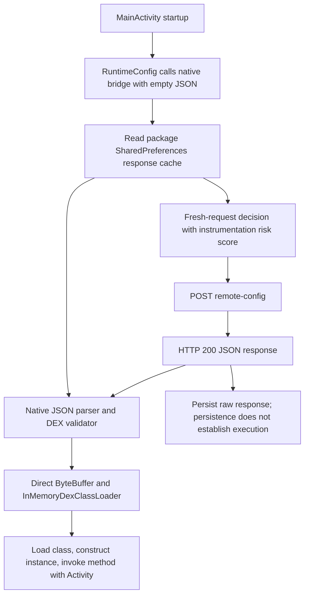

# Family4 — 5555xBasin

The saved app `dev.tracebasinmoss.routepearl` v1.0.5 can receive a JSON response,
validate embedded DEX bytes, and invoke a response-selected instance method with
its Activity. This capability was demonstrated on the original Pixel app using a
local benign response supplied through HTTP Toolkit, without app hooks or patches.

The complete 86-APK split set is preserved under
`samples/family4/dev.tracebasinmoss.routepearl/`. There are three ARM64 native library
names; the app-specific implementation is `libz5555xbasin.so`. The other names are
`libsigner.so` and `libandroidx.graphics.path.so`.



The response uses an outer object and fifteen selected fields: fourteen Java/JNI
names/descriptors plus an integer DEX byte array. There is no separate JSON field
for expected size. The native validator checks decoded length **112–33,554,432**,
DEX version/header/endian consistency, exact file/container size and table bounds.

Generate a proof response from the full split input:

```bash
scripts/venv_python scripts/analyze_family4_native.py \
  samples/family4/dev.tracebasinmoss.routepearl \
  --out work/family4/new-analysis.json \
  --proof-response work/family4/new-proof-response.json
```

The standalone distribution is `portable/family4.zip`; its README gives environment
setup and response-replacement instructions. It includes the same source-built,
hash-pinned 5,120-byte benign fixture used in previous cases. No new compilation or
Blutter version is needed.

The primary detector is structural extraction in `scripts/family4_native.py`;
`detections/yara/family4_native_loader.yar` is a conservative compiler-scoped triage
rule. The extractor derives selectors and JNI bindings from each submitted input,
not a file hash or response pack. Unknown layouts remain `needs_review`.

Evidence:

- [Static triage](dev.tracebasinmoss.routepearl/00_static_triage.md)
- [Java bootstrap](dev.tracebasinmoss.routepearl/01_code_audit.md)
- [Native flow, keys, guards and anti-analysis](dev.tracebasinmoss.routepearl/02_native_analysis.md)
- [Five network/response trials](dev.tracebasinmoss.routepearl/03_network_analysis.md)
- [Detection validation](dev.tracebasinmoss.routepearl/04_detection_report.md)
- [Runtime and script validation](dev.tracebasinmoss.routepearl/05_validation.md)

One original app has been analyzed; synthetic mutations demonstrate bounded
variation coverage. Remote loading alone does not establish malicious intent,
common operators or the behavior of an unseen production payload. This experiment
supplied a benign response locally and did not retrieve a production DEX.
